# Nexus Ops — Enterprise SaaS Dashboard Demo & Starter

[](https://github.com/brathod1432/saas-dashboard-demo/actions/workflows/ci.yml)
[](LICENSE)
[](https://nextjs.org)
[](https://www.typescriptlang.org)

A production-quality **Business Operations Platform** demo that doubles as a reusable SaaS
starter template. Built to show how modern business software _should_ be built —
**security-first, accessible, observable, and production-ready** — not just how it can look.

> **Demo mode:** data is seeded in memory and authentication is simulated. Sign in as Admin,
> Manager, User, or Viewer with password `password`. Never enter real credentials.

## Highlights

- 🔐 **Security-first** — 3-layer RBAC (route + page + service), signed HttpOnly session,
  input validation (shared Zod), output encoding, CSP + security headers, audit trail.
- ♿ **Accessible** — WCAG AA target: keyboard nav, focus management, ARIA, reduced motion;
  automated jest-axe + Playwright checks.
- 📈 **Real dashboards** — KPIs, revenue/user/channel charts (Recharts), activity, alerts.
- 🗂️ **Enterprise data tables** — sort, filter, search, paginate, bulk actions, column
  visibility, CSV export (with formula-injection protection), and per-row view/edit/delete.
- ⌘ **Command palette (⌘K)** — global search across customers, projects, and invoices.
- 🧱 **Clean architecture** — UI → hooks → clients → route handlers → services → repositories.
  Swap the mock backend for a real one by changing **two layers**.
- 🔭 **Observable** — structured logging, metrics, tracing spans, health checks.
- 🎨 **Re-skinnable** — `/showcase` re-themes the starter into 8 verticals.

## Screenshots

> Captured from the running app. Full set in [`docs/screenshots/`](docs/screenshots).
> Regenerate anytime with `node scripts/capture-screenshots.mjs` (app running).

### Dashboard — KPIs, charts, activity, alerts, audit trail

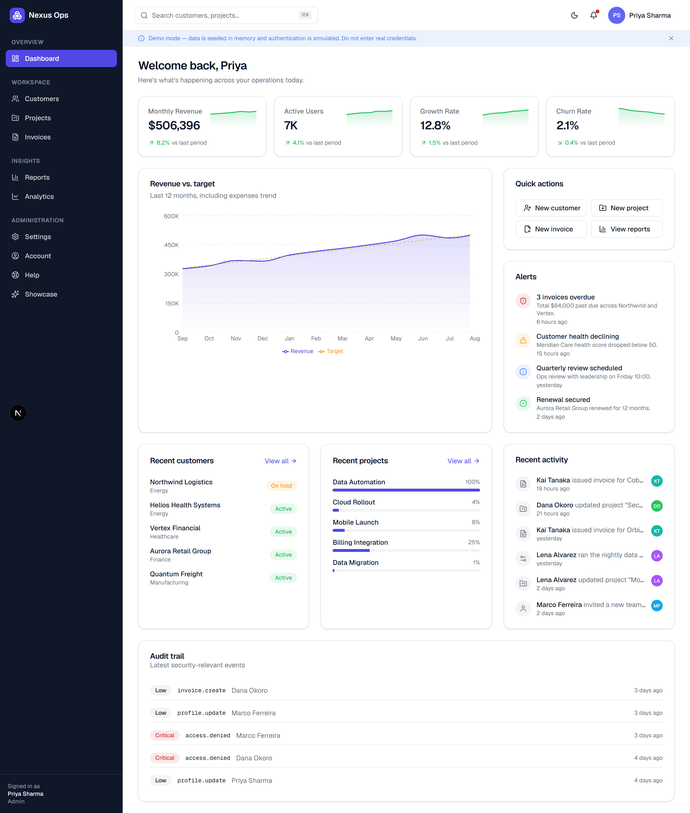

<table>
  <tr>
    <td width="50%"><strong>Dashboard — dark mode</strong><br/>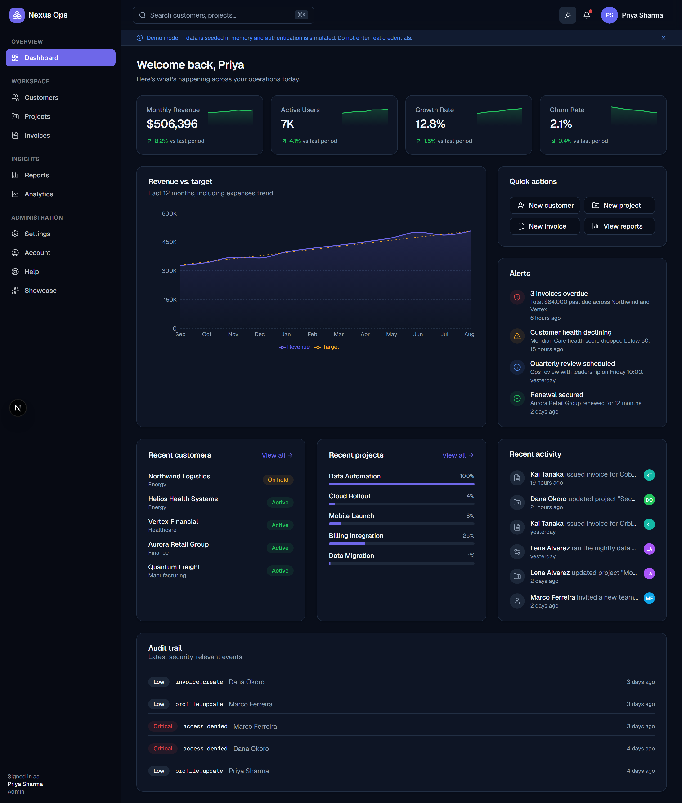</td>
    <td width="50%"><strong>Sign in (with quick demo roles)</strong><br/>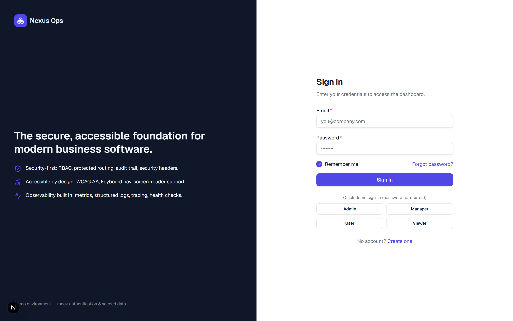</td>
  </tr>
  <tr>
    <td><strong>Customers — enterprise data table</strong><br/>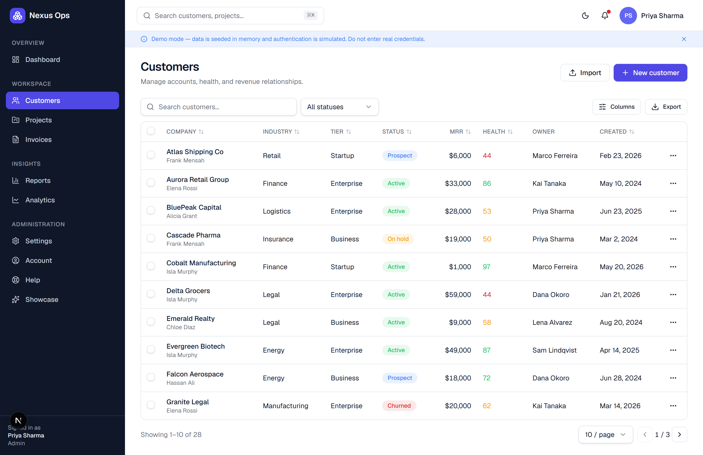</td>
    <td><strong>Customer detail</strong><br/>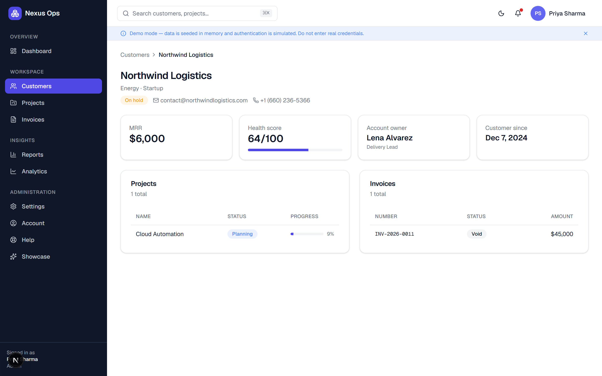</td>
  </tr>
  <tr>
    <td><strong>Projects</strong><br/>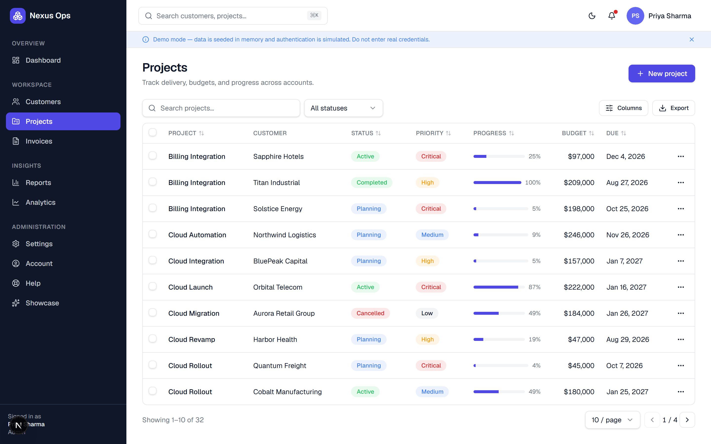</td>
    <td><strong>Invoices</strong><br/>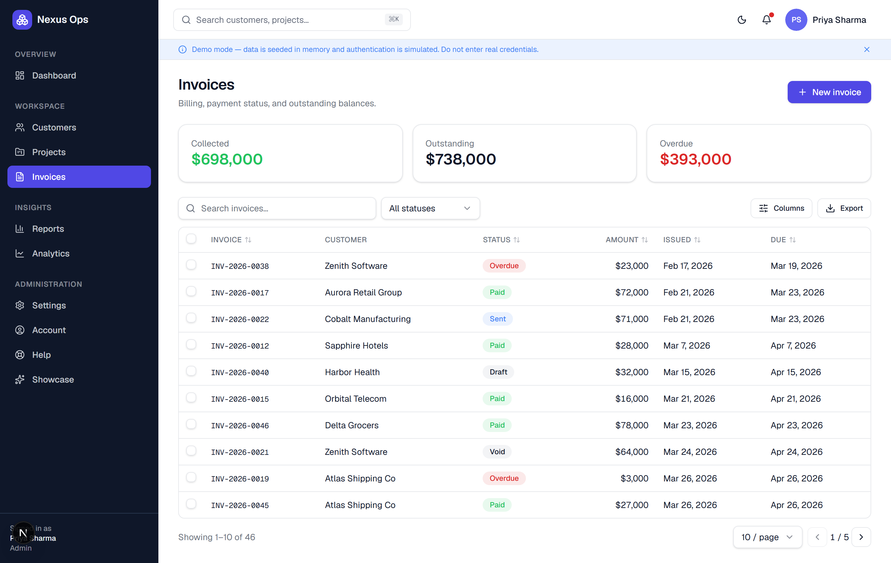</td>
  </tr>
  <tr>
    <td><strong>Reports</strong><br/>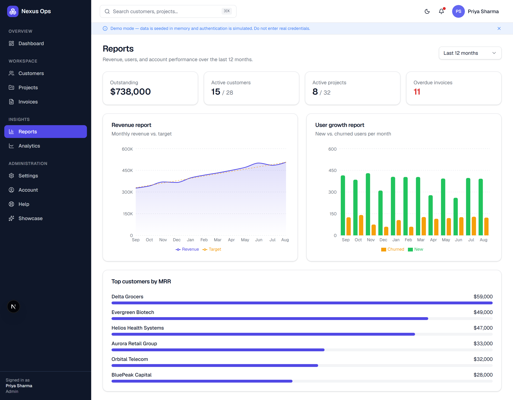</td>
    <td><strong>Analytics</strong><br/>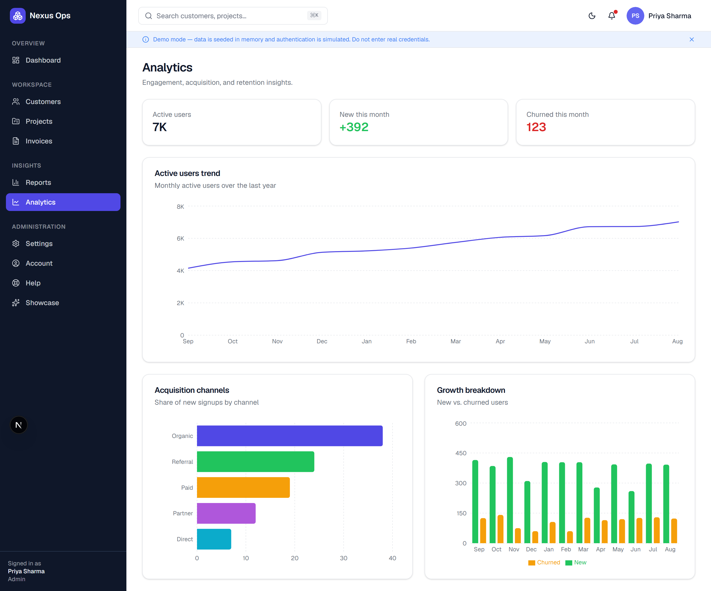</td>
  </tr>
  <tr>
    <td><strong>Settings — RBAC permission matrix</strong><br/>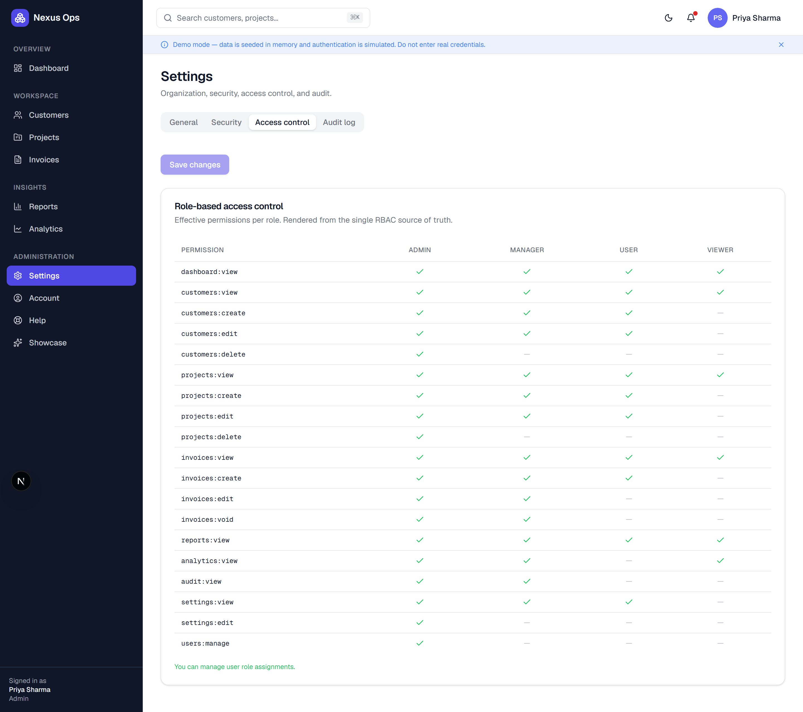</td>
    <td><strong>Portfolio showcase (re-skins)</strong><br/>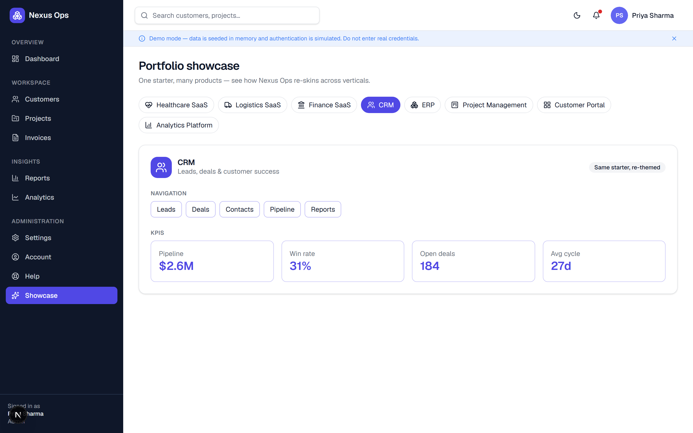</td>
  </tr>
  <tr>
    <td colspan="2"><strong>Landing page</strong><br/>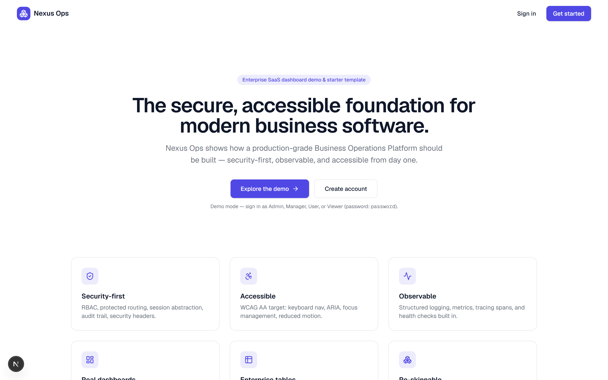</td>
  </tr>
</table>

## Tech stack

Next.js 16 (App Router · RSC · Turbopack) · React 19 · TypeScript (strict) · Tailwind CSS v4 ·
shadcn/Radix UI · Zustand · TanStack Query · React Hook Form + Zod · Recharts · Jest + RTL +
jest-axe · Playwright · ESLint + Prettier + Husky.

Every dependency and design source was security- and license-reviewed before use — see
[`docs/security-review.md`](docs/security-review.md) and
[`docs/design-research.md`](docs/design-research.md).

## Quick start

```bash
npm ci
npm run dev        # http://localhost:3000
```

Then open `/login` and use **Quick demo sign-in**. Full instructions:
[`docs/setup.md`](docs/setup.md).

## Scripts

`dev` · `build` · `start` · `lint` · `format` · `typecheck` · `test` · `coverage` · `e2e` ·
`audit` (see [`docs/setup.md`](docs/setup.md)).

## Project structure (top level)

```
src/app/        (auth) & (app) route groups, api/ route handlers, landing, layout
src/components/ ui kit, layout, data-table, charts, feature components, auth, forms, shared
src/hooks/      TanStack Query hooks
src/lib/        api (repos/clients/services), auth, rbac, audit, observability, validation, mock
src/proxy.ts    route guard (Next 16 "middleware")
docs/           full documentation set
e2e/            Playwright specs
```

## Status

- ✅ Production build passes · ✅ ESLint clean · ✅ `tsc` clean
- ✅ 60 Jest tests · ✅ 12 Playwright E2E tests · ✅ `npm audit`: 0 vulnerabilities
- Core-logic coverage ≈ 87% statements / 80% branches

See the full assessment in [`docs/final-audit.md`](docs/final-audit.md).

## Documentation

| Doc                                                                                                                                    |                                    |
| -------------------------------------------------------------------------------------------------------------------------------------- | ---------------------------------- |
| [Discovery](docs/discovery.md)                                                                                                         | Vision, personas, roadmap, risks   |
| [Improvements](docs/improvements.md)                                                                                                   | User + security improvement report |
| [Architecture](docs/architecture.md)                                                                                                   | Layered design & data flow         |
| [Design system](docs/design-system.md)                                                                                                 | Tokens, components, patterns       |
| [Design research](docs/design-research.md)                                                                                             | Vetted design sources              |
| [Security model](docs/security-model.md)                                                                                               | Trust boundaries & STRIDE          |
| [Security implementation](docs/security-implementation.md)                                                                             | Concrete controls                  |
| [Security review](docs/security-review.md)                                                                                             | Dependency vetting                 |
| [Security audit](docs/security-audit.md)                                                                                               | Findings & risk score              |
| [RBAC](docs/rbac.md)                                                                                                                   | Roles, matrix, enforcement         |
| [Observability](docs/observability.md)                                                                                                 | Logs, metrics, tracing, health     |
| [Testing](docs/testing.md)                                                                                                             | Strategy & how to run              |
| [Accessibility](docs/accessibility.md)                                                                                                 | WCAG AA approach                   |
| [Performance](docs/performance.md)                                                                                                     | Budgets & techniques               |
| [Setup](docs/setup.md) · [Deployment](docs/deployment.md) · [Customization](docs/customization.md) · [Roadmap](docs/future-roadmap.md) | Operate & extend                   |

## Contributing & security

- Contribution guide: [`CONTRIBUTING.md`](CONTRIBUTING.md) · Code of Conduct: [`CODE_OF_CONDUCT.md`](CODE_OF_CONDUCT.md)
- Report vulnerabilities privately: [`SECURITY.md`](SECURITY.md)

## License

Licensed under the [MIT License](LICENSE) © 2026 Brijesh Rathod.

**Disclaimer:** this is a demonstration/starter project. Authentication and data are
simulated — **not** production security. Review [`docs/security-model.md`](docs/security-model.md)
before adapting for production.
